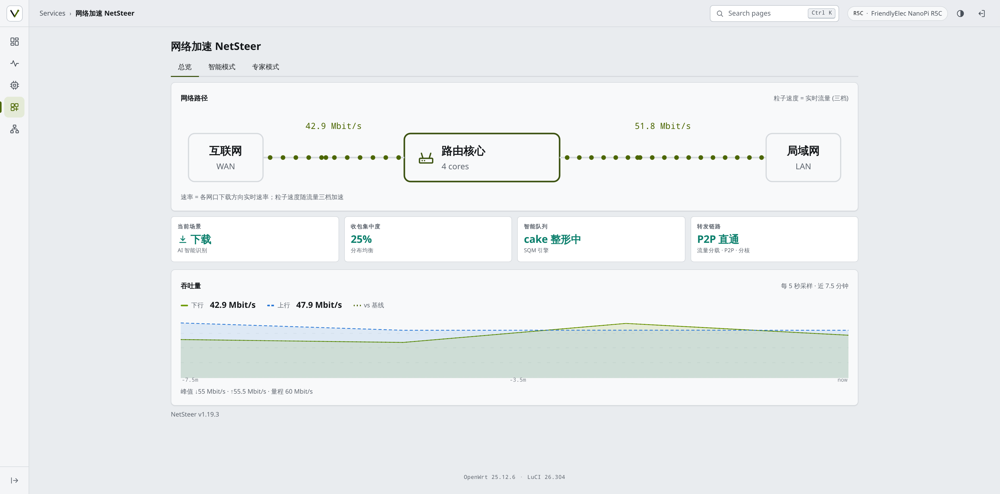
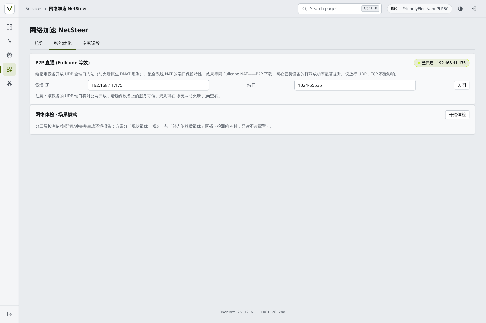
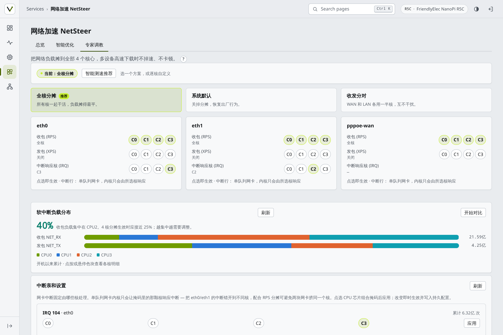
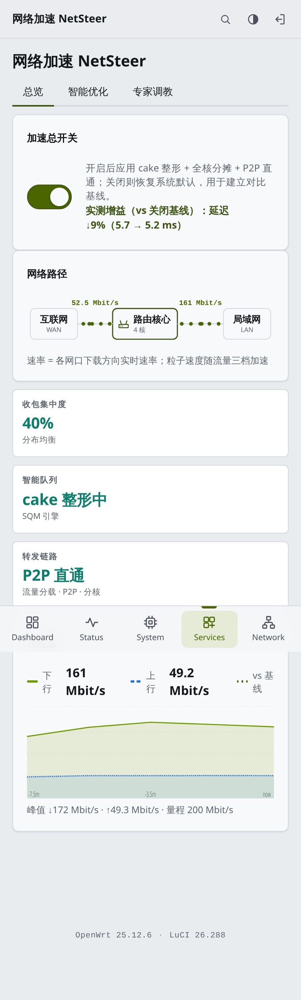
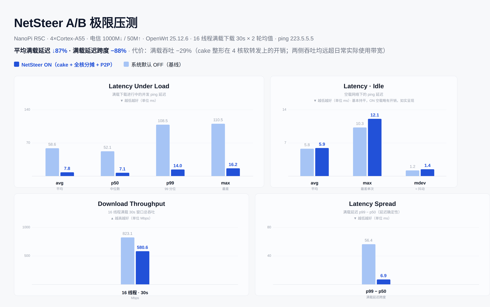

# NetSteer — The Integrated Network Accelerator for OpenWrt

[English](README.md) | [简体中文](README.zh-CN.md)

[](https://github.com/pm-parker/netsteer/actions/workflows/ci.yml) [](LICENSE)

> **[dnsworker.com](https://dnsworker.com)** — free in-browser **[bufferbloat test](https://dnsworker.com/)** + OpenWrt acceleration guides. See your loaded latency, then fix it with NetSteer in one toggle. Also in [Deutsch](https://dnsworker.com/de/) / [Русский](https://dnsworker.com/ru/) / [Türkçe](https://dnsworker.com/tr/) / [Español](https://dnsworker.com/es/).

**The cFosSpeed for OpenWrt: smart queue shaping, multi-core load spreading, IRQ affinity and P2P passthrough — integrated into one package with measured A/B gain comparison.**

One master toggle, two worlds: off, it restores stock behavior and automatically benchmarks the baseline; on, cake shaping + all-core spreading + P2P passthrough take effect and the page shows the real measured gain versus that baseline — latency ↓9% (5.7 → 5.2 ms, an 8-second on-device measurement), not a marketing number.



*Live on NanoPi R5C · OpenWrt 25.12.6 · LuCI 26.288. Master toggle on (P2P mode); wire-path particles speed up with real traffic across three tiers; the throughput chart carries a "vs baseline" gain reference line.*

## What it solves

Home-router network trouble is rarely single-dimensional: upstream congestion spikes game latency (needs queue shaping), bulk downloads saturate one core and tank throughput (needs multi-core spreading), P2P hole-punching fails (needs Fullcone-style passthrough) — and above all, "did any of this tuning actually help?" (needs measurable comparison).

Each direction has standalone tools: SQM for shaping, hand-written sysfs for spreading, firewall rules for passthrough — but they don't talk to each other, and none ships a unified UI for normal users. NetSteer integrates all four into three pages: casual users read the overview dashboard, intermediate users run one-click audits and scenario modes, experts tune per-core — and every change at every level shows up live on the same dashboard.

## Key features

| | |
|---|---|
| **Master toggle + A/B gain** | Off auto-benchmarks the stock baseline (real ping latency + throughput sampling); on shows the measured gain percentage. Numbers come from the router itself — idle networks honestly report "parity" |
| **Live dashboard** | Wire-path particle flow (speed = live traffic, 3 tiers), RX-concentration / smart-queue / forwarding health cards, up/down throughput curves + gain reference line |
| **One-click audit** | Multi-dimensional checks (SQM / softirq concentration / forwarding / offloading) with conflict flags; missing deps get two-tier suggestions (no-install alternative or the exact install command) |
| **Scenario modes** | Balanced / throughput / low-latency / core-steering / P2P — each a declarative action set (cake profile, RPS masks, IRQ policy), instant and reboot-persistent |
| **Game device priority lane** | Pin one device (console/PC): all its traffic is DSCP CS4-marked (nftables, both directions) into cake's video tin — bandwidth-share protection under saturation (**2.47x** measured share under full load), with live per-tin rate counters on the page so the effect is verifiable, not a black box |
| **Game platform detection (3-plane)** | Live per-device host labels via a three-stage chain: hostname (SNI sniffing / DNS query, [cache-domains](https://github.com/uklans/cache-domains) MIT) → bare-IP segment match (Valve official SDR relay data, `gameips.txt`) → well-known ports (3074 console NAT etc., `gameports.txt`). Covers bare-IP direct game traffic that has no domain name at all. Classification runs in the browser, zero cost on the router. The observation plane auto-adapts to your home network: with a proxy core (Nikki / OpenClash / clash-family, API-probed) it reads the connection table; on a bare router it falls back to dnsmasq query logs (one-click enable); with neither it says so honestly. Plus DHCP-hostname game-console suggestions to fill the device IP |
| **Scene sensing (cFosSpeed-style)** | Tells you what your network is doing right now: gaming / video call / streaming / download / normal. Each scene has its own detection logic — a game-platform hit with light traffic is a match session, the same domain pulling gigabytes is a store download (light/heavy analysis, the `bulk_detect` idea), Zoom/Teams/Meet domains and STUN/TURN UDP flows mark work calls, streaming CDNs mark video. Scoring with user-benefit priority, every verdict comes with an explainable evidence list, and a 2-window debounce prevents flapping. Runs on the same connection-table observation plane, zero extra cost on the router |
| **Remote data feed** | Recognition datasets (game domains / IP segments / ports / streaming domains / P2P ports) update without reinstalling: maintainers refresh the data in this repo, users pull it with one click (jsDelivr CDN → GitHub raw → custom `netsteer.feed.url` mirror). sha256 manifest verification, atomic replace, automatic rollback on any failure — the shipped dataset always works offline as the baseline |
| **Environment auto-adaptation** | At boot the plugin probes your actual home network — proxy core type & API liveness, DNS observation plane, WAN gateway for latency probes — and caches the result; no manual configuration to fit the plugin, it fits your network instead |
| **P2P passthrough** | One-click UDP full-port inbound DNAT (Fullcone-equivalent) for any LAN device — big win for BT/PT/online-game NAT traversal; native fw4 rules, idempotent add/remove |
| **Expert tuning** | Per-interface per-core RPS/XPS switches, visual IRQ affinity editor with before/after softirq delta measurement; PPPoE virtual interfaces included |
| **Guardian** | Config-vs-runtime reconciliation every minute; drift auto-repaired and evidence persisted |
| **Device-agnostic** | Cores, interfaces, IRQ numbers all runtime-probed, zero hardcoding; sensible defaults generated per hardware on first install; built-in benchmark measures *your* device and recommends the best plan |

## Screenshots

Overview (master toggle + wire path + throughput) | Smart optimize (audit + modes)
---|---
 | 

Expert tuning (per-core + IRQ affinity) | Mobile
---|---
 | 

Mobile is a first-class citizen: 44px touch targets, tap equivalents for every hover interaction, single-column cards, light/dark theme auto-follow.

### Extreme A/B benchmark (v1.12.4 · measured on-device)



*NanoPi R5C · China Telecom 1000M↓/50M↑: 16-thread saturated download for 30s × 2 runs, concurrent ping during the load. With NetSteer on (cake + all-core spreading + P2P): **average loaded latency ↓87%** (58.6 → 7.8 ms) and **loaded latency spread −88%** (56.4 → 6.9 ms) — gaming/video-call latency no longer explodes during bulk downloads. The cost is stated honestly: loaded throughput −29% (cake shaping overhead on 4-core software forwarding; both sides far exceed everyday usage), idle latency roughly par (slight overhead when on). Benchmark scripts ship with the repo (`scripts/bench-ab-*.sh`) — reproduce on your own device.*

### Historical benchmark (v1.6 era, core-spreading only)


*NanoPi R5C (4 cores, single-queue GbE), same 20 parallel HTTPS downloads: +17% sustained RX throughput with the recommended plan, busiest-core share unchanged.*

## Install

> [!IMPORTANT]
> **Requires OpenWrt 25.x+ (apk package manager).** Older stable releases (24.10 and earlier) ship `opkg` and cannot install these `.apk` files — you'll get `pkg_init_from_file: Malformed package file`. Verify with `apk --version` on your router before downloading.

### Option A — Release package (recommended)

Grab the `.apk` matching your architecture from [Releases](https://github.com/pm-parker/netsteer/releases) (check `cat /etc/apk/arch` on the router), copy it over, then:

```sh
apk add --allow-untrusted /tmp/luci-app-netsteer-*.apk
```

The package enables boot autostart, clears the LuCI menu cache and reloads rpcd. First open walks you through initial setup. Requires OpenWrt 24.10+/25.12 (apk package format).

### Option B — Manual install

```sh
scp -O files/usr/bin/netsteer-* root@ROUTER_IP:/usr/bin/
scp -O files/etc/init.d/netsteer root@ROUTER_IP:/etc/init.d/
scp -O files/www/luci-static/resources/view/netsteer.js root@ROUTER_IP:/www/luci-static/resources/view/
scp -O files/usr/share/luci/menu.d/luci-app-netsteer.json root@ROUTER_IP:/usr/share/luci/menu.d/
scp -O files/usr/share/rpcd/acl.d/luci-app-netsteer.json root@ROUTER_IP:/usr/share/rpcd/acl.d/
ssh root@ROUTER_IP 'chmod +x /usr/bin/netsteer-* /etc/init.d/netsteer && /etc/init.d/netsteer enable && /etc/init.d/netsteer start && rm -f /tmp/luci-indexcache* && /etc/init.d/rpcd restart'
```

Then open **Services → NetSteer** in LuCI.

### Uninstall

```sh
apk del luci-app-netsteer
# /etc/config/netsteer is kept (config survives upgrades); remove manually for a full wipe
```

## How it works

NetSteer is an integration layer — it invents no new mechanisms, it drives existing kernel facilities, so behavior is predictable and fully reversible:

- **Queue shaping**: SQM/cake (`/etc/config/sqm`) for latency control under upstream congestion; scenario modes switch profiles, master toggle disables while keeping config
- **RPS/XPS** (`/sys/class/net/*/queues/*/rps_cpus`, `xps_cpus`): spreads packet processing across cores — fixes single-core saturation on single-queue NICs
- **IRQ affinity** (`/proc/irq/*/smp_affinity`): pins NIC interrupts to less busy cores, staggered across interfaces
- **P2P passthrough**: fw4/nftables rules for UDP full-port DNAT (Fullcone-equivalent)
- **Game priority lane**: nftables DSCP CS4 marking for one device IP -> cake diffserv4 video tin (up+down) + egress ack-filter; idempotent, hotplug self-healing, honest five-state badge that visibly degrades when SQM is off; turning it off restores the stock sqm script
- **Gain measurement**: `netsteer-bench` runs an 8-second window of real ping latency + per-interface throughput sampling, baselines persisted to uci; triggered automatically in the background on master-toggle switches and compared on the page
- **Loaded-latency probe**: `netsteer-bloat` measures idle latency vs latency under an 8-stream CDN download (with measured load Mbps), writes verdict to uci; manual trigger from the dashboard. Honest boundary: on gigabit links this validates shaping health and a capacity lower bound (~200 Mbps load on-device) — full-saturation bufferbloat measurement needs external load (flent-style), see script header notes
- **Thermal guard**: `netsteer-check` samples the hottest thermal zone every minute into `/tmp/netsteer/health.json`; ≥85°C logs a warning (10-min anti-spam), ≥95°C auto-downgrades to the steering profile with an incident log (no auto-restore — the UI tells you when to re-enable)
- **netsteer-apply** declaratively writes sysfs from UCI config, records applied state, idempotent at boot
- **netsteer-check** (cron, every minute) reconciles runtime vs config, auto-repairs drift and persists evidence to `/etc/netsteer/incidents/`
- **Scene sensing (v1.17.4+, proxy-free)**: traffic evidence comes from the kernel conntrack table via netlink (`conntrack -L`, needs `apk add conntrack`; byte accounting via `nf_conntrack_acct=1`, enabled automatically) — zero dependency on any proxy core. When mihomo/clash is present it is used as an optional enhancement (SNI hostnames are more precise); domain names otherwise come from dnsmasq query-log reply lookups where available. Sensing channel auto-selects: mihomo → conntrack → dnsmasq (override with `uci set netsteer.qos.dns_observer=<auto|mihomo|conntrack|dnsmasq>`)

Everything is reversible: the master toggle restores stock behavior; the `System default` preset restores kernel defaults.

## Troubleshooting & feedback

One command collects everything needed to debug your setup — SSH to the router and run:

```sh
netsteer-doctor
```

It prints ten sections (package version, environment, SQM state, offload flags, observation channel, scene engine, acceleration tunnels, steering state, config, recent logs) and a final `VERDICT` line with known-boundary warnings (missing deps, flow-offload counter freeze, daemon leaks, degraded DNS observation). Paste the full output when [opening an issue](https://github.com/pm-parker/netsteer/issues) — the issue template asks for exactly this.

## Honest limits

- Gain percentages are measured on your box; idle networks show small deltas (honestly reported as "parity") — cake's payoff shows under upstream congestion
- Single-queue NICs have a physical floor on spreading evenness — the built-in benchmark shows your device's real numbers, no fixed promises
- The benchmark runs ~30s of real download traffic; run it during normal usage hours for representative samples
- Tested on NanoPi R5C (aarch64_generic, 4 cores, OpenWrt 25.12.6). Any ARM/x86_64 device with standard sysfs should work; if yours doesn't, open an issue with `cat /sys/devices/system/cpu/online` and `ls /sys/class/net/` output

## Development & testing

- `node tests/unit/core.test.js` — 138 pure-function assertions (multi-core logic / baseline parsing / plan scoring; runs in CI on every push)
- `tests/e2e/e2e.py` — 69 full-page browser assertions against a real router (re-run on a clean uninstall/reinstall before every release)
- `scripts/build-apk.sh <version> <arch>` — reproduce the official .apk locally; CI builds 4 architectures per push with per-package `apk verify`, and attaches them to the GitHub Release (with release notes) on tags
- On-device procedures (install/reinstall cycles, A/B comparisons, reboot persistence) are documented in tests/README.md

## Release notes

Highlights / additions / fixes for every version live in [Releases](https://github.com/pm-parker/netsteer/releases) and the `release-notes/` directory in this repo.

## License

MIT — see [LICENSE](LICENSE).
