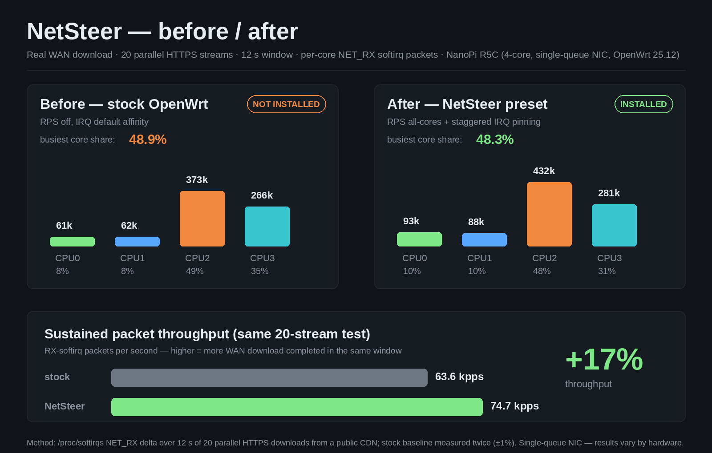

# NetSteer — network load steering for OpenWrt

[English](README.md) | [简体中文](README.zh-CN.md)

[](https://github.com/pm-parker/netsteer/actions/workflows/ci.yml) [](LICENSE)

**Stop letting one CPU core do all the networking.** NetSteer is a LuCI app for OpenWrt 24.10+/25.12 that spreads network softirq and interrupt load across all CPU cores — with a live dashboard, one-click presets, and a built-in auto-benchmark that measures *your* router and recommends *your* best setting.



*Real measurement on a NanoPi R5C (4-core, single-queue GbE, OpenWrt 25.12): same 20-stream HTTPS download, +17% sustained RX throughput with NetSteer's preset, busiest-core share unchanged, idle cores now participating. Stock baseline measured twice for reproducibility (±1%). Results vary by hardware — that's exactly why the app benchmarks your device instead of guessing.*

## Why

On most ARM routers the network stack runs on whatever core the NIC interrupt lands on. Under heavy WAN download that core saturates first: throughput sags, latency spikes, and the other cores sit idle. The kernel already has the answer — RPS/XPS (packet steering) and IRQ affinity — but tuning it by hand means reading sysfs documentation and hex masks.

NetSteer turns that into three buttons.

## What you get

| | |
|---|---|
| **One-click presets** | `All-cores` (recommended), `Stock`, `RX/TX split` — applied instantly, persisted across reboots |
| **Auto-benchmark** | Real-traffic sampling of each candidate preset, ~30 s, recommends the most even one — adopt it or keep your current setup. Your pre-test config is always restored automatically |
| **Live dashboard** | Per-core RX/TX softirq distribution with tap-to-inspect bars, busiest-core share at a glance |
| **Per-core control** | Toggle RPS/XPS/IRQ per interface, per core — PPPoE virtual interfaces included |
| **Guard daemon** | Background watcher that detects and *self-heals* any drift between config and live sysfs state, logging evidence to a persistent incident directory |
| **Works on any device** | Core count, interfaces and IRQ numbers are detected at runtime — nothing is hardcoded for a specific board. First install auto-generates a sane default for *your* hardware |
| **P2P passthrough** | One-click UDP full-port inbound DNAT for a chosen device (Fullcone-equivalent) — dramatically better P2P hole-punching. Native fw4 rules, visible in the LuCI firewall page, idempotently added/removed by the toggle |

## Screenshots

Desktop dashboard | Auto-benchmark result
---|---
 | 

Built-in help popover | Mobile
---|---
 | 

Mobile is a first-class target: 44px touch targets, tap equivalents for every hover interaction, single-column cards — matching the LuCI dashboard look.

## Install

### Option A — apk package (OpenWrt 24.10+/25.12)

Download `dist/luci-app-netsteer-1.8.0.apk` from this repo, copy it to the router, then:

```sh
apk add --allow-untrusted /tmp/luci-app-netsteer-1.8.0.apk
```

The package enables the service at boot, clears the LuCI menu cache and reloads rpcd. On first open the page offers a guided setup.

### Option B — manual install

```sh
scp -O files/usr/bin/netsteer-apply files/usr/bin/netsteer-check files/usr/bin/netsteer-detect root@ROUTER:/usr/bin/
scp -O files/etc/init.d/netsteer root@ROUTER:/etc/init.d/
scp -O files/www/luci-static/resources/view/netsteer.js root@ROUTER:/www/luci-static/resources/view/
scp -O files/usr/share/luci/menu.d/luci-app-netsteer.json root@ROUTER:/usr/share/luci/menu.d/
scp -O files/usr/share/rpcd/acl.d/luci-app-netsteer.json root@ROUTER:/usr/share/rpcd/acl.d/
ssh root@ROUTER 'chmod +x /usr/bin/netsteer-* /etc/init.d/netsteer && /etc/init.d/netsteer enable && /etc/init.d/netsteer start && rm -f /tmp/luci-indexcache* && /etc/init.d/rpcd restart'
```

Then open **Services → NetSteer** in LuCI.

### Uninstall

```sh
apk del luci-app-netsteer
# /etc/config/netsteer is intentionally kept — delete it too if you want a clean slate
```

## How it works

- **RPS/XPS** (`/sys/class/net/*/queues/*/rps_cpus`, `xps_cpus`) — spreads packet processing across cores.
- **IRQ affinity** (`/proc/irq/*/smp_affinity`) — pins NIC interrupts away from the busiest cores, staggered per interface.
- **netsteer-apply** writes sysfs from UCI config, records the applied state, and runs idempotently at boot.
- **netsteer-check** (cron, 1/min) reconciles live state vs config and auto-repairs drift, logging evidence to `/etc/netsteer/incidents/`.
- **netsteer-detect** generates a first-boot default from the actual hardware (core count, physical interfaces, PPPoE) — no hardcoded board assumptions.

Everything is reversible: the `Stock` preset restores kernel defaults.

## Honest limits

- Single-queue NICs have a physical floor on how even the distribution can get — the auto-benchmark shows your device's real numbers instead of promising a fixed gain.
- The benchmark drives real download traffic (~30 s); run it during normal usage for a representative sample.
- Tested on NanoPi R5C (aarch64_generic, 4-core, OpenWrt 25.12.6). Any ARM/x86_64 device with standard sysfs should work; if yours doesn't, please open an issue with the output of `cat /sys/devices/system/cpu/online` and `ls /sys/class/net/`.

## Development & testing

- `node tests/unit/core.test.js` — 34 assertions over the multi-core logic (runs in CI on every push)
- `tests/e2e/e2e.py` — full browser pass against a live router (manual, see tests/README.md)
- `scripts/build-apk.sh <version> <arch>` — reproduces the shipped .apk locally; CI builds 4 arches on every push and attaches them to GitHub Releases on tags
- Hardware-in-the-loop checks (real-device install/uninstall round-trip, WAN A/B benchmark, reboot persistence) are documented in tests/README.md

## License

MIT — see [LICENSE](LICENSE).
