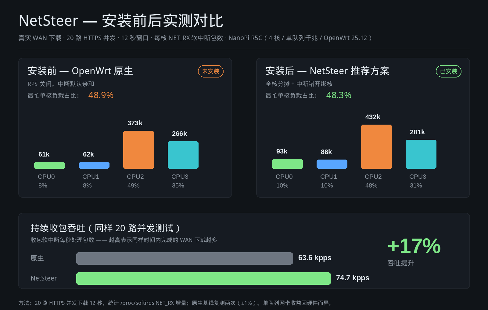
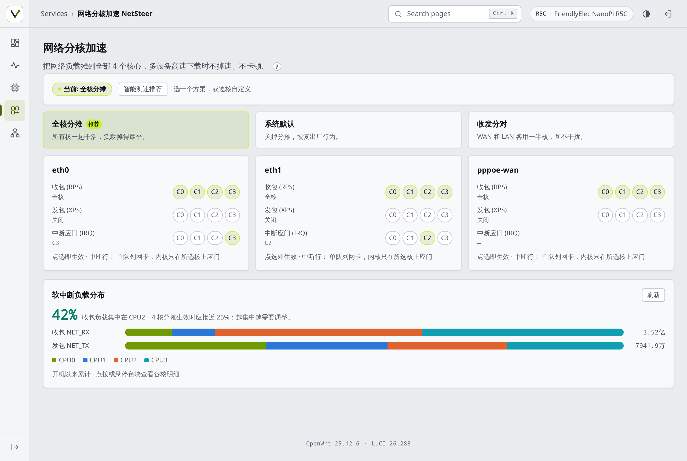
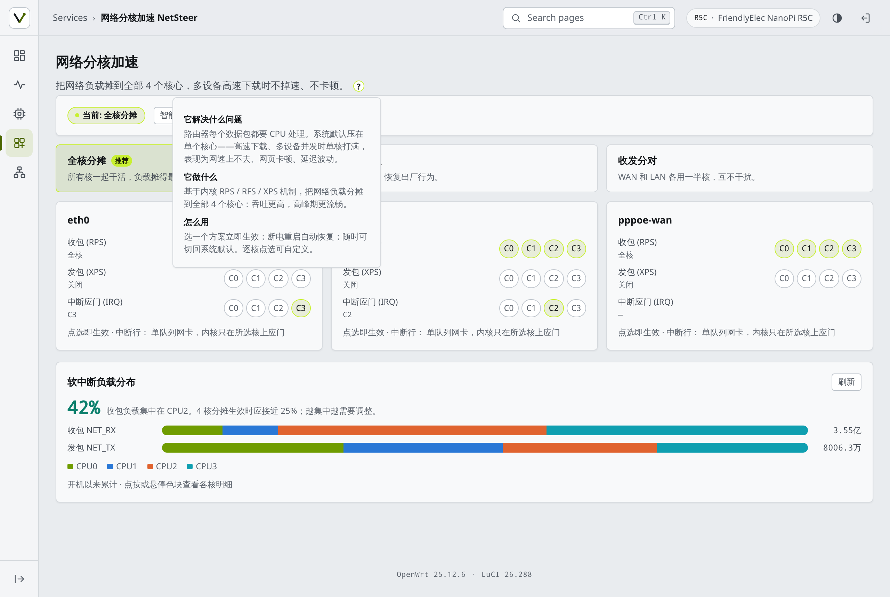
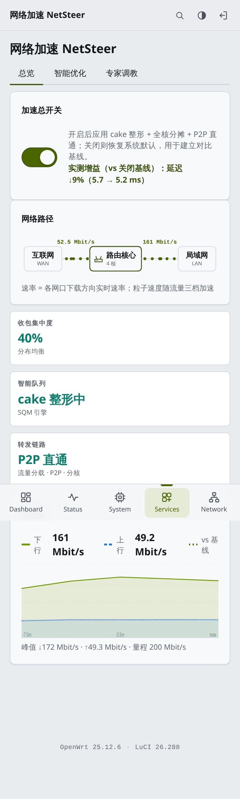

# NetSteer — OpenWrt 网络负载分核加速

[English](README.md) | [简体中文](README.zh-CN.md)

[](https://github.com/pm-parker/netsteer/actions/workflows/ci.yml) [](LICENSE)

**别让一个 CPU 核独自扛下所有网络流量。** NetSteer 是一个 OpenWrt 24.10+/25.12 的 LuCI 应用，把网络软中断与中断负载摊到全部 CPU 核——实时仪表盘、一键预设、内置自动压测（实测你的设备、推荐你的最优方案）。



*NanoPi R5C（4 核、单队列千兆、OpenWrt 25.12）实测：同样 20 路 HTTPS 下载，开启 NetSteer 推荐方案后持续收包吞吐 **+17%**，最忙核占比不升，闲置核开始参与。原生基线复测两次（±1%）。不同硬件收益不同——所以应用内置压测，测你的设备，而不是承诺固定数字。*

## 解决什么问题

多数 ARM 路由器上，整个网络协议栈跑在网卡中断落到的那个核上。WAN 大流量下载时这个核最先饱和：吞吐掉速、延迟抖动，其他核闲着。内核早就有答案——RPS/XPS（包转向）与 IRQ 亲和——但手工调优要啃 sysfs 文档和十六进制掩码。

NetSteer 把它变成三个按钮。

## 功能

| | |
|---|---|
| **一键预设** | `全核分摊`（推荐）、`系统默认`、`收发分对`——即时生效、重启保持 |
| **智能测速** | 真实流量采样各候选方案（约 30 秒），推荐最均匀的一个；采纳或保持原状都行，测速前配置自动恢复 |
| **实时仪表盘** | 每核收/发包软中断分布，点按色块看明细，最忙核占比一眼可见 |
| **逐核控制** | 每个接口、每个核独立开关 RPS/XPS/IRQ，PPPoE 虚拟口同样支持 |
| **守卫后台** | 每分钟对账配置与运行态，发现漂移自动修复并存证到持久目录 |
| **跨设备通用** | 核数、接口、IRQ 号全部运行时探测，零硬编码；首装自动为你的硬件生成合理默认值 |
| **P2P 直通** | 一键给指定设备开 UDP 全端口入站（Fullcone 等效），P2P 打洞成功率显著提升；fw4 原生规则，LuCI 防火墙页可见，随开关幂等增删 |

## 截图

桌面仪表盘 | 智能测速结果
---|---
 | 

内置帮助浮窗 | 移动端
---|---
 | 

移动端是一等公民：44px 触控热区、所有悬停交互都有点按等价物、单列卡片布局，与 LuCI 仪表盘风格一致。

## 安装

### 方式 A — apk 安装包（OpenWrt 24.10+/25.12）

从本仓库下载 `dist/luci-app-netsteer-1.7.0.apk`，拷到路由器后：

```sh
apk add --allow-untrusted /tmp/luci-app-netsteer-1.7.0.apk
```

安装包会启用开机自启、清 LuCI 菜单缓存并重载 rpcd。首次打开页面会引导初始设置。

### 方式 B — 手动安装

```sh
scp -O files/usr/bin/netsteer-apply files/usr/bin/netsteer-check files/usr/bin/netsteer-detect root@路由器IP:/usr/bin/
scp -O files/etc/init.d/netsteer root@路由器IP:/etc/init.d/
scp -O files/www/luci-static/resources/view/netsteer.js root@路由器IP:/www/luci-static/resources/view/
scp -O files/usr/share/luci/menu.d/luci-app-netsteer.json root@路由器IP:/usr/share/luci/menu.d/
scp -O files/usr/share/rpcd/acl.d/luci-app-netsteer.json root@路由器IP:/usr/share/rpcd/acl.d/
ssh root@路由器IP 'chmod +x /usr/bin/netsteer-* /etc/init.d/netsteer && /etc/init.d/netsteer enable && /etc/init.d/netsteer start && rm -f /tmp/luci-indexcache* && /etc/init.d/rpcd restart'
```

然后在 LuCI 打开 **服务 → NetSteer**。

### 卸载

```sh
apk del luci-app-netsteer
# /etc/config/netsteer 会保留（升级不丢配置）；需要彻底清理就手动删掉
```

## 原理

- **RPS/XPS**（`/sys/class/net/*/queues/*/rps_cpus`、`xps_cpus`）——把包处理摊到多核。
- **IRQ 亲和**（`/proc/irq/*/smp_affinity`）——网卡中断钉在较闲的核上，多接口错开。
- **netsteer-apply** 从 UCI 配置写 sysfs，记录已应用状态，开机幂等执行。
- **netsteer-check**（cron 每分钟）对账运行态与配置，自动修复漂移并存证到 `/etc/netsteer/incidents/`。
- **netsteer-detect** 首启按真实硬件（核数、物理接口、PPPoE）生成默认配置——无任何板级硬编码。

一切可逆：`系统默认` 预设恢复内核出厂行为。

## 诚实的边界

- 单队列网卡的分摊均匀度有物理下限——自动压测给你看设备真实数字，不承诺固定收益。
- 压测会跑约 30 秒真实下载流量；在正常使用时段跑，样本更有代表性。
- 已在 NanoPi R5C（aarch64_generic、4 核、OpenWrt 25.12.6）实测。任何带标准 sysfs 的 ARM/x86_64 设备理论上可用；如果你的设备不行，请开 issue 附上 `cat /sys/devices/system/cpu/online` 与 `ls /sys/class/net/` 输出。

## 开发与测试

- `node tests/unit/core.test.js` —— 34 项多核逻辑断言（每次 push 在 CI 自动跑）
- `tests/e2e/e2e.py` —— 面向真实路由器的整页浏览器测试（手动跑，见 tests/README.md）
- `scripts/build-apk.sh <版本> <arch>` —— 本地复现正式 .apk；CI 每次 push 自动构建 4 种架构，打 tag 时自动附到 GitHub Release
- 真机环节（设备上装卸重装、WAN 下载 A/B 对比、重启持久化）记录在 tests/README.md

## 许可

MIT——见 [LICENSE](LICENSE)。
