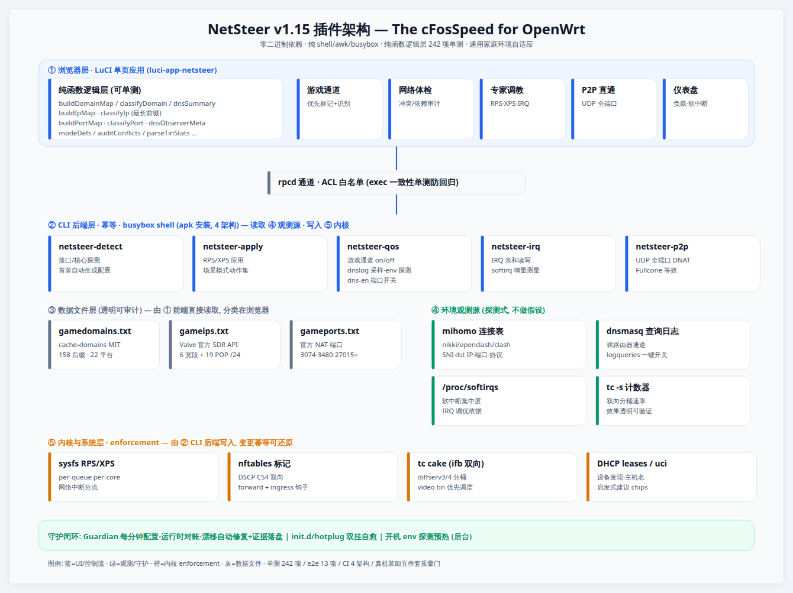
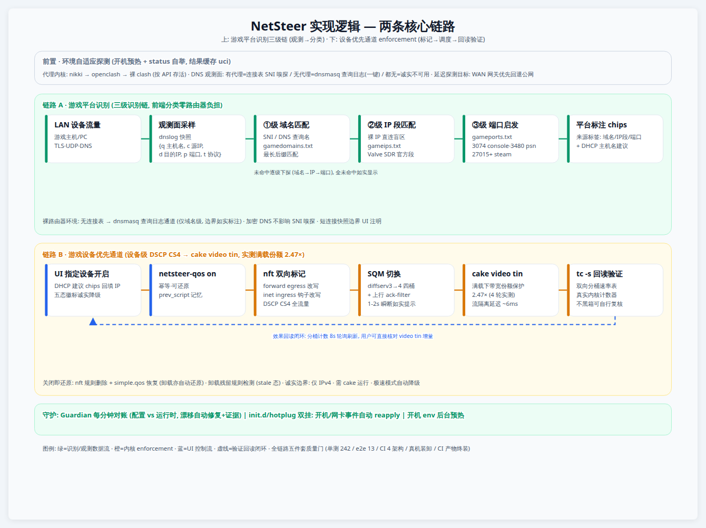

# v1.15.0 — L2 识别增强层（IP 段 + 端口启发式）

### 版本特色

游戏平台识别升级为**三级识别链**：域名（SNI/DNS 查询名）→ 裸 IP 段（官方数据）→ 知名端口（官方 NAT 端口）。补上 L1 的最大盲区——**裸 IP 直连**：游戏主机的实时联机流量走 Steam SDR relay / Xbox Live 时没有域名可匹配，现在靠 Valve 官方公开的 relay IP 表和平台官方端口直接命中。

### 路线说明（为什么不是 nDPI）

原规划的 nDPI 路线经实测判死：OpenWrt 25.12 feed 的 `libndpi` 包只有 `.so` 库、不含 `ndpiReader` 命令行工具，要用它就得自己交叉编译工具并按 4 个架构随插件分发二进制——违反插件零二进制依赖原则（D2），维护成本也高。替代路线用纯数据文件，零依赖、零抓包、分类照旧在浏览器完成，路由器零负担。

### 新增

- **三级识别**：识别链 = 域名 → IP 段 → 端口；明细行标注命中来源（域名 / IP 段 / 端口）
- **gameips.txt**（Steam 段，来自 Valve 官方 SDR API）：AS32590 共识宽段（155.133/16、162.254/16 等 6 条）+ 合作 POP /24 归并（19 条，含中国区 relay）；生成脚本随仓库分发可随时重拉
- **gameports.txt**（官方文档端口）：3074 TCP/UDP（Xbox Live / PSN NAT，console 类）、3480/tcp（PSN）、27015-27050/udp 与 27036-27037/tcp（Steam）；**3478-3479 刻意不收**（通用 STUN/TURN 端口，误判率高）——取舍以注释写在数据文件里
- **采样升级**：连接快照每条带目的地 IP / 端口 / 协议；纯裸 IP 连接不再被丢弃（这正是 L2 的输入）

### 实测（NanoPi R5C · Nikki/mihomo）

- 端到端：构造到 Steam relay 的裸 IP TCP 连接（无任何域名），采样即出现 `d=155.133.248.36`，IP 段匹配命中 steam
- UDP 场景：连接表 `destinationIP` 字段有值实锤（真实流量样本）；测试用 UDP 包被 relay 拒收无法构造端到端演示，如实标注为边界
- 质量门：单测 242 全绿（基线 215，+27）；真机 e2e 13 项；4 架构 apk verify

### 已知边界

- IP 段/端口两级识别仅代理内核观测面可用（dnsmasq 查询日志通道只有域名维度——它本来就有名字可匹配，盲区更小）
- Xbox/PSN/Epic 的官方 IP 段不公开，不做假数据；这三家靠域名与端口两级覆盖
- IP 段是快照数据（生成日期与 revision 写在文件头）；Steam relay 段历史上很稳定，但不是永不过期的承诺

### 架构与实现逻辑图

整体五层架构（浏览器 LuCI 单页 → rpcd ACL → CLI 后端 → 数据文件/观测源 → 内核 enforcement + 守护闭环）与两条核心链路（游戏平台识别三级链、设备优先通道 enforcement 链）：

可缩放矢量版本：[架构图 HTML](../docs/diagrams/netsteer-arch.html) · [实现逻辑图 HTML](../docs/diagrams/netsteer-logic.html)
